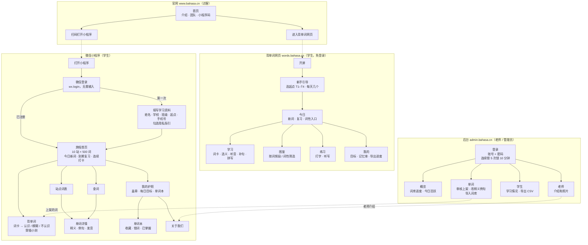
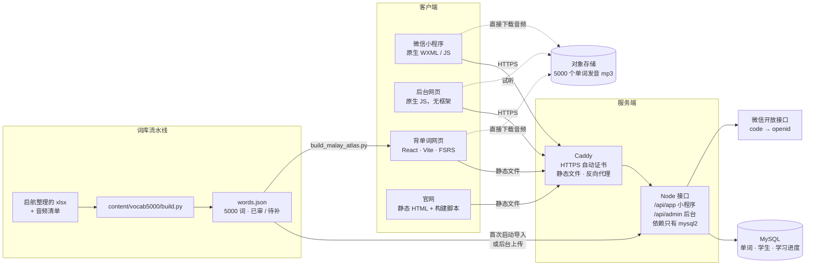
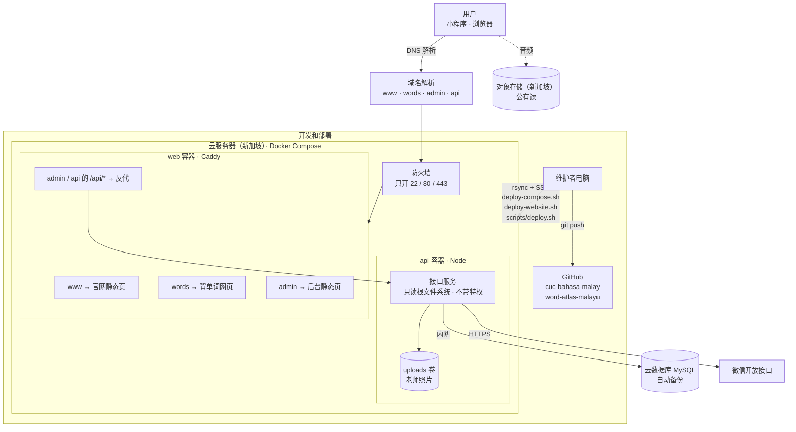

# JomBelajar 架构

三张图：谁用什么界面、系统由哪些部分组成、服务器上怎么部署。图用 Mermaid 写，GitHub 上直接显示，改文字就能改图。

> 这是公开仓库。图里和文档里不写服务器 IP、内网地址、账号、密钥和存储桶名；这些只在维护者本机的 `ops/`（已在 `.gitignore`）和服务器的 `.env` 里。

## 1. 用户和界面

四种入口，三类人。学生主要用**微信小程序**；不想装小程序的也可以直接打开**背单词网页**（不用登录，进度存在自己浏览器里）；老师在**后台**管词库和看学生；**官网**只负责介绍和引流。

## 2. 技术架构

所有客户端都很薄：小程序和后台网页只调用同一个 Node 接口；背单词网页是纯静态，词库打包成 JSON，进度存在浏览器。词库只有一个源头：启航整理的 xlsx。

几个约定：

- **登录**：小程序用微信 `code` 换 `openid`，服务端签发自己的 token，不存微信会话。后台是单个管理员账号，密码只存 scrypt 哈希。背单词网页不登录。
- **复习算法**：小程序用盒子法（1 / 1 / 2 / 4 / 7 / 15 / 30 天）；背单词网页用 FSRS。
- **审核**：只有 `approved` 的词会出现在学生端；标了「待复核」的释义学生看不到。
- **音频**：库里只存文件名，接口拼上 `AUDIO_BASE` 返回，客户端直接从对象存储下载，不经过服务器。

## 3. 服务器架构

一台新加坡云服务器跑两个容器；数据库和音频用云服务，备份由云数据库负责。学生主要在马来西亚，新加坡最近。

部署脚本：

| 脚本 | 做什么 |
|---|---|
| `deploy/deploy-compose.sh` | 上传接口代码、后台网页、Caddy 配置，重建 `api` 容器，重载 Caddy |
| `deploy/deploy-website.sh` | 构建官网，同步到 `website/`（不碰 `words/`） |
| `word-atlas-malayu/scripts/deploy.sh` | 构建背单词网页，同步到 `website/words/` |
| `deploy/server-setup.sh` | 新服务器第一次初始化：Docker、swap、目录 |

脚本默认连 `~/.ssh/config` 里的主机别名 `jombelajar`，仓库里不写服务器地址。
